# Projects

### 1. World Cup 2026 Predictor
Probabilistic forecasting model for the 2026 World Cup using international 
match data (Poisson distribution and Elo based team strength, tournament simulation).
Built the full pipeline: data ingestion, rating system, simulator, evaluation.

- **Repo:** [world-cup-2026-predictor](https://github.com/adam-a-k/world-cup-2026-predictor)
- **Write-up:** [Medium article](https://medium.com/@adam.a-k/how-ive-predicted-the-2026-world-cup-here-s-what-it-says-about-england-s-chances-8eb4ff9c2164)

### 2. Customer facing chatbot - Internship
Built a Python backend hosted on Azure, integrating HubSpot API for a chatbot using Azure Open AI. Implemented RAG using Azure AI Search, using company data to mitigate hallucinations. Integrated an order lookup feature for the chatbot to retrieve live information on customer orders when asked. Created a fallback mechanism to notify and hand over to staff when suitable. 

> "Bringing in somebody with specialist AI knowledge gave us fresh thinking 
> and helped us turn ideas into something practical for the business. The 
> support has been invaluable, both technically and strategically."
>
> — Kris Theophanous, CEO, [Bradbury Tracks](https://www.madesmarter.uk/resources/case-study-bradbury-tracks/)

- **Code:** Private (employer confidentiality), happy to discuss in interview.
- **High-Level Overview**:
 

### 3. Research Project - MSc Artificial Intelligence
Interactive policy evaluation tool applying causal inference (OLS, mixed-effects models, LinearDML) to multi-source public data (ONS, Census, IMD, NHS) for estimating the impact of government funding policy at granular LSOA (Lower Layer Super Output Area) level in England. Includes geospatial mapping (GeoPandas) and automated parameter-search optimisation, built in Streamlit so policymakers can compare funding configurations and view estimated impact across England.

- **Code:** Withheld pending final marking confirmation, happy to walk 
  through methodology and findings in interview.

### 4. Data Economy Group Project (team of 4) — MSc Artificial Intelligence, University of Southampton
**Topic: Data Integration and Warehousing**

End-to-end financial data pipeline ingesting live market data (stocks, forex, crypto, news) via multiple APIs, with ETL transformations and a PostgreSQL warehouse, surfaced through a React/Flask dashboard with role-based access control. My role: designed the PostgreSQL schema and data-loading layer, taking cleaned data from the ETL stage through to query-ready storage.

- **Repo:** [comp6265-group1-financial-data-pipeline](https://github.com/adam-a-k/comp6265-group1-financial-data-pipeline)
